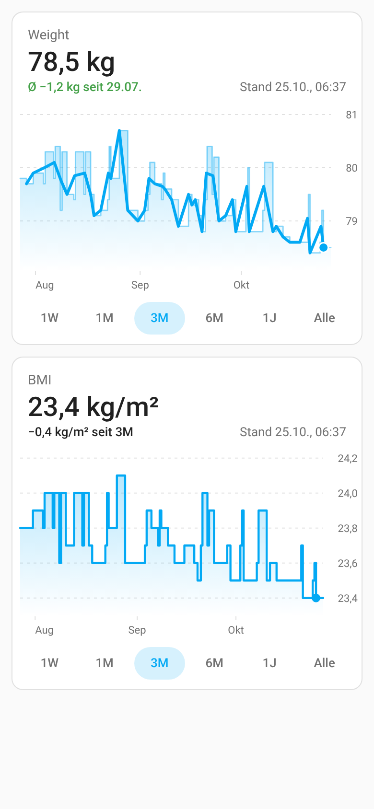
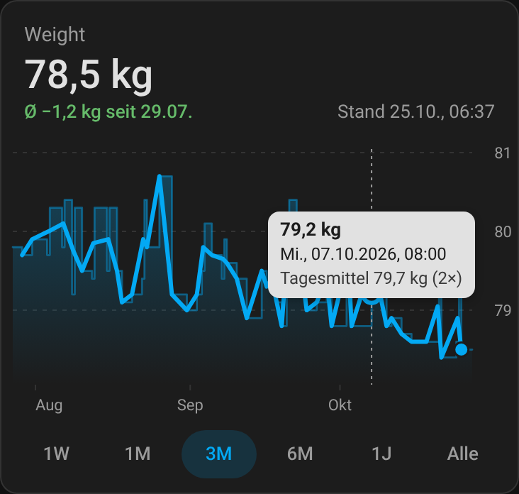
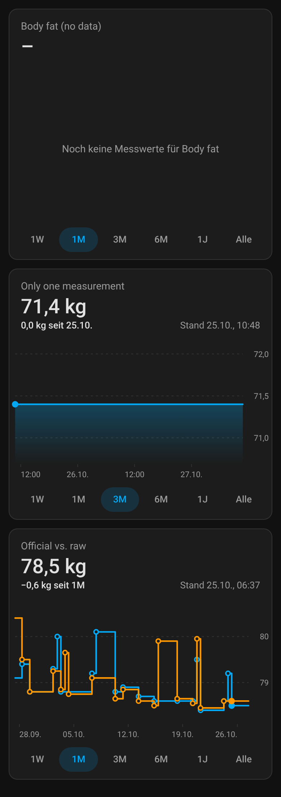

# Range Graph Card

A Home Assistant dashboard card that shows the history of a numeric entity like a stock chart:
**range buttons** (1W, 1M, 3M, 6M, 1Y, All), a step line that **always fills the card**, the current value and the change over the selected range, and a crosshair tooltip for mouse and touch.

Made for values that change rarely, such as body weight, BMI or body measurements, where the built-in history graph shows months of empty space before the first few data points.

  [](https://hacs.xyz)

| Light | Dark, tooltip | Special cases |
|---|---|---|
|  |  |  |

## Features
- **Range buttons** like a stock app. Default `1w, 1m, 3m, 6m, 1y, all`, any of `<n>h`, `<n>d`, `<n>w`, `<n>m`, `<n>y` and `all` can be configured. The chosen range is remembered per card (browser `localStorage`).
- **Never half empty**: the x axis runs from the later of *range start* and *first data point* to *now*. The y axis fits the visible values with a little headroom (or fixed `min`/`max`). One single value is shown as a dot with a line to now, an entity without any numeric value shows a clear hint.
- **Step line** (a value is valid until the next one) with dots for every change, the latest value highlighted.
- **Header** with the current value and the change over the range, e.g. `−1.2 kg since 1M`. If the data starts later than the range, the change is shown since the first date. `good_direction` colours the change green or red.
- **Daily mean mode** for values measured several times a day (e.g. weight in the morning and evening): `change_basis: daily_mean` compares the mean of the last day with the mean of the first day with data, so a single evening weigh-in does not flip the colour. `trend_line: daily_mean` draws the daily means as a bold connected line over a thinner, faded step line, and the tooltip adds the day's mean.
- **Tooltip / crosshair** on hover, tap or drag (vertical page scrolling keeps working on phones). Value plus localized date and time.
- **History + long-term statistics**: the card reads the recorder history (`history/history_during_period`). For periods the recorder has already purged (default after 10 days) it fills in long-term statistics (`recorder/statistics_during_period`), so 6M/1Y/All keep working. This needs a `state_class` on the sensor (e.g. `measurement`).
- **Live**: reloads when the entity changes.
- Several entities in one card (shared y axis), theme colours, dark mode, English and German labels (follows the Home Assistant language).
- One small JavaScript file, no build step, no external runtime dependencies, all text rendered escaped.

## Installation

### HACS (custom repository)
1. HACS → ⋮ → **Custom repositories** → add `https://github.com/LuFuhrmann/range-graph-card`, category **Dashboard**.
2. Search for **Range Graph Card**, download it.
3. Reload the browser (in the Companion app: Settings → Companion app → Debugging → *Reset frontend cache*).

### Manual
1. Download `range-graph-card.js` from the [latest release](https://github.com/LuFuhrmann/range-graph-card/releases).
2. Copy it to `/config/www/range-graph-card.js`.
3. Settings → Dashboards → ⋮ → **Resources** → add `/local/range-graph-card.js?v=1.0.0`, type **JavaScript module**. Increase `?v=` after every update.

## Configuration

```yaml
type: custom:range-graph-card
entity: sensor.body_weight
title: Weight
default_range: 1m
good_direction: down
change_basis: daily_mean
trend_line: daily_mean
```

Several entities:

```yaml
type: custom:range-graph-card
title: Official vs. raw
entities:
  - entity: sensor.body_weight
    name: Official
  - entity: sensor.scale_weight
    name: Raw
    color: "#ff9800"
ranges: [1w, 1m, 3m, all]
```

| Option | Type | Default | Description |
|---|---|---|---|
| `entity` | string | – | Numeric entity. Use `entity` **or** `entities`. |
| `entities` | list | – | Entity IDs or objects with `entity`, `name`, `color`, `unit`, `decimals`, `statistic_id`. The first one drives the header. |
| `name` | string | friendly name | Name of `entity` (tooltip, empty hint). |
| `title` | string | `name` | Card title. `""` hides it. |
| `ranges` | list | `[1w, 1m, 3m, 6m, 1y, all]` | Range buttons. `<n>h`, `<n>d`, `<n>w`, `<n>m`, `<n>y` or `all`. |
| `default_range` | string | `1m` | Range used until the user picks one. |
| `storage_key` | string | entity IDs + title | Key for the remembered range. Set it to share or separate the choice between cards. |
| `height` | number | `200` | Chart height in px. |
| `min` / `max` | number | auto | Fixed y axis bounds. |
| `decimals` | number | auto (1–2) | Decimals for values and the change. |
| `unit` | string | entity unit | Overrides the unit. |
| `good_direction` | `none` \| `up` \| `down` | `none` | Colours the change green when it goes this way, red otherwise. |
| `change_basis` | `value` \| `daily_mean` | `value` | `value`: current value minus the value at the start of the visible range. `daily_mean`: mean of the last day minus mean of the first day with data in the range (local time), shown with `Ø`. With only one day of data the header shows that day's mean and no colour. |
| `trend_line` | `none` \| `daily_mean` | `none` | Bold line and dots through the daily means (placed at the mean time of the day's values); the step line becomes thin and faded. |
| `show_points` | `auto` \| `true` \| `false` | `auto` | Dots for every change; `auto` hides them when there are too many. |
| `show_updated` | bool | `true` | Shows the time of the latest value. |
| `statistics` | bool | `true` | Fill purged history from long-term statistics. |

Per entity, `statistic_id` reads the statistics from another ID (for example an external statistic such as `myimport:weight`).

## Notes and limitations
- Long-term statistics are hourly means (daily means for ranges over 100 days). Where they are used, a change shows up at the start of its hour or day, and a day with two different values shows their mean.
- Daily means are plain averages of the values recorded that day. A day without measurements is bridged by the trend line.
- If the same value is measured twice in a row, Home Assistant records no state change, so it is one dot.
- Times use the browser's time zone.

## Development
No build step: `range-graph-card.js` is the card.

```bash
npm test                     # unit tests (node:test, no dependencies)
npm install                  # only for the screenshot script (playwright-core)
TZ=Europe/Berlin npm run screenshots   # headless Chrome with a mocked hass, writes screenshots/
```

## License
[MIT](LICENSE)
